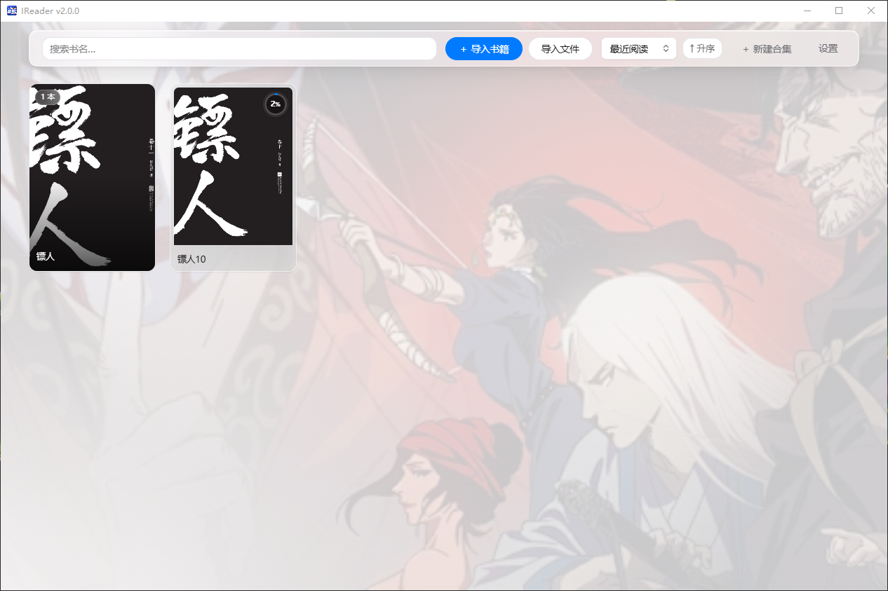
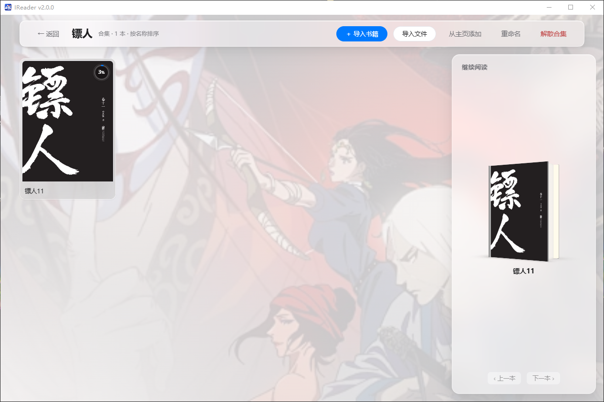
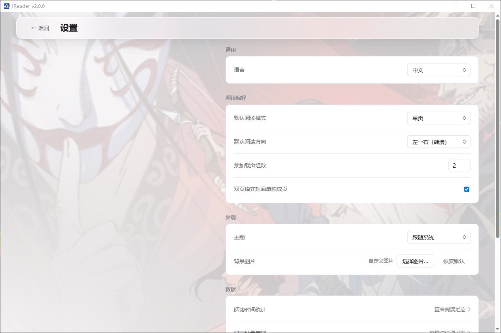

一句话概括，这是在原版之上修改的适配了nhentai-jmcomic-downloader下载器(有一些下载器的问题会更新迭代)
            然后依据我个人的审美去更新了页面与布局(等我完成下载器的迭代,会再次更改阅读器并搬上新功能)

*文库主页 —— 一个图片文件夹就是一本漫画，顶部是悬浮胶囊搜索栏，背景可换自定义图*

---

> **关于本仓库**：这是 [hi-done/ireader](https://github.com/hi-done/ireader) 的**修改版**
> （上游基线 `v2.0.0`，MIT）。原作者 **hi-done**，上游项目：<https://github.com/hi-done/ireader>
>
> 我在上游基础上加了 **图片文件夹漫画（一个目录 = 一本书）**、**画廊 `info.json` 元数据**、
> **自定义背景图**，并把界面重做了一遍（悬浮胶囊 / 玻璃书卡 / 设置页右对齐）。
> 逐文件改动（含行号）见 **[`CHANGES.md`](./CHANGES.md)**；源码里每个改动文件头部都有
> `[FEAT]` / `[MOD]` 标记，打开文件第一行就能看到。

## 🔖 我改了哪里（相对上游 `v2.0.0`）

下面每一条都对应源码文件**第一行**的标记：`[FEAT]` = 新增文件、`[MOD]` = 修改文件。
在 GitHub 上点文件名就能看到那行标记；带行号的完整清单见 [`CHANGES.md`](./CHANGES.md)。

### 🆕 新增功能（4 个源码 + 3 个测试）

| 文件 | 标记 | 在 v2.0.0 基础上增加了什么 |
| --- | --- | --- |
| [`electron/services/dirService.ts`](./electron/services/dirService.ts) | `[FEAT]` | **图片文件夹漫画**：一个目录 = 一本书，按文件名自然序列页、逐页读图、分卷子目录上提 |
| [`electron/services/libraryScan.ts`](./electron/services/libraryScan.ts) | `[FEAT]` | **导入扫描**：目录直接含图片就整目录算一本，否则递归下钻；跳过隐藏目录 / `__MACOSX` / 符号链接 |
| [`electron/services/galleryInfo.ts`](./electron/services/galleryInfo.ts) | `[FEAT]` | **画廊 `info.json`**：书名只取 `full_title`（中文 > 日文 > 原文）、作者自动归合集、`gallery_id` 去重 |
| [`electron/services/backgroundService.ts`](./electron/services/backgroundService.ts) | `[FEAT]` | **自定义背景图**：复制进 `userData/backgrounds`，经 `ireader://background/{name}` 供图 |
| `dirService.test.ts` · `libraryScan.test.ts` · `galleryInfo.test.ts` | `[FEAT]` | 上述三项的单测（共 3 个文件） |

### ✏️ 主进程改动（10 个）

| 文件 | 标记 | 改了什么 |
| --- | --- | --- |
| [`shared/types.ts`](./shared/types.ts) | `[MOD]` | `BookFormat` 加 `'dir'`；新增 `PagedImageFormat`、`Book.author`、`Settings.background` |
| [`electron/services/protocol.ts`](./electron/services/protocol.ts) | `[MOD]` | 新增 `ireader://dir/{id}/{page}`、`ireader://background/{name}`；逐页供图合并成 `servePagedImage` |
| [`electron/services/libraryService.ts`](./electron/services/libraryService.ts) | `[MOD]` | 导入改走扫描；图片页数入库；`dir` 删书不删目录；空作者合集清理 |
| [`electron/db/database.ts`](./electron/db/database.ts) | `[MOD]` | 迁移追加 **v8**：`author_key` / `author_name` / `gallery_id` |
| [`electron/db/repos/booksRepo.ts`](./electron/db/repos/booksRepo.ts) | `[MOD]` | 作者列读写、`findByGalleryId()` 去重、`countByCollection()` |
| [`electron/db/repos/collectionsRepo.ts`](./electron/db/repos/collectionsRepo.ts) | `[MOD]` | `author_key`、`findByAuthorKey()`、`listAutoCreated()` |
| [`electron/ipc/handlers.ts`](./electron/ipc/handlers.ts) | `[MOD]` | 导入对话框改**多选文件夹**；新增 `background:choose` / `background:reset` |
| [`electron/preload.ts`](./electron/preload.ts) | `[MOD]` | `pickFolder()` 返回多路径；新增 `background.choose()` |
| [`electron/main.ts`](./electron/main.ts) | `[MOD]` | 启动时 `initBackgroundService(userDataDir)` |
| [`electron/services/appLocale.ts`](./electron/services/appLocale.ts) | `[MOD]` | 图片文件对话框过滤器名（三语言） |

### ✏️ 渲染层改动（13 个）

| 文件 | 标记 | 改了什么 |
| --- | --- | --- |
| [`src/services/imagePage.ts`](./src/services/imagePage.ts) | `[MOD]` | 逐页图片渲染认 `dir` 格式 |
| [`src/services/pageThumbnail.ts`](./src/services/pageThumbnail.ts) | `[MOD]` | 侧栏内页缩略图认 `dir` |
| [`src/services/coverQueue.ts`](./src/services/coverQueue.ts) | `[MOD]` | 封面队列支持 `dir` |
| [`src/stores/reader.ts`](./src/stores/reader.ts) | `[MOD]` | 打开 `dir` 走图片页管线；空目录提示按格式区分 |
| [`src/services/ipc.ts`](./src/services/ipc.ts) | `[MOD]` | `background.choose()` 接线 |
| [`src/views/LibraryManageView.vue`](./src/views/LibraryManageView.vue) | `[MOD]` | 格式列显示「图片文件夹」；删书提示「文件夹已保留」 |
| [`src/i18n/locales/zh-CN.ts`](./src/i18n/locales/zh-CN.ts) · [`en.ts`](./src/i18n/locales/en.ts) · [`ja.ts`](./src/i18n/locales/ja.ts) | `[MOD]` | 三语同步：背景图 / `importFiles` / `dir` 提示 / 删除保留文件夹 |
| `libraryList.test.ts` · `libraryManage.test.ts` | `[MOD]` | 测试用例跟随新增格式调整 |

### 🎨 界面改动（8 个）

| 文件 | 标记 | 改了什么 |
| --- | --- | --- |
| [`src/views/LibraryView.vue`](./src/views/LibraryView.vue) | `[MOD]` | 删首屏 hero；导入入口进头部/工具行；顶部**悬浮胶囊**并按滚动条宽度对齐 |
| [`src/components/library/BookCard.vue`](./src/components/library/BookCard.vue) | `[MOD]` | **整卡光感玻璃**；书名底座透明；**不可写 `overflow:hidden`**（Chromium 网格 bug） |
| [`src/components/library/CollectionCard.vue`](./src/components/library/CollectionCard.vue) | `[MOD]` | 占位高度少抵 9px，与书卡底线齐平 |
| [`src/components/ui/CardTip.vue`](./src/components/ui/CardTip.vue) | `[MOD]` | 提示框**液态玻璃**（`backdrop-filter: blur(18px)`） |
| [`src/style.css`](./src/style.css) | `[MOD]` | `--page-bg-image`、`--tip-*` 玻璃令牌、`.page-head` 胶囊、删 `--hero-veil` |
| [`src/theme.ts`](./src/theme.ts) | `[MOD]` | 跟随设置改写 `--page-bg-image` |
| [`src/views/SettingsView.vue`](./src/views/SettingsView.vue) | `[MOD]` | 新增「背景图片」行；设置面板**右对齐** |
| `AiConfigView.vue` · `ReadingStatsView.vue` | `[MOD]` | 接入整窗背景层（各 1 行） |

### 📄 文档（3 个）

| 文件 | 标记 | 作用 |
| --- | --- | --- |
| [`CHANGES.md`](./CHANGES.md) | `[FEAT]` | 逐文件改动清单（带**行号区间**与具体说明） |
| [`UPSTREAM.md`](./UPSTREAM.md) | `[FEAT]` | 上游来源、基线版本、同步上游的方法 |
| [`NOTICE`](./NOTICE) | `[FEAT]` | MIT 署名说明（再分发须保留 `LICENSE` + `NOTICE`） |

> 另有 **15 个文件只是行尾符（CRLF→LF）被统一**，内容一字未动，diff 里会出现但不用管，
> 清单见 [`CHANGES.md` §四](./CHANGES.md)。

## 🖼 本仓库新增功能实拍

<table>
  <tr>
    <td width="50%" align="center">
       
      <b>图片文件夹漫画</b> —— 一个目录 = 一本书，进度圆环、合集、搜索都在
    </td>
    <td width="50%" align="center">
       
      <b>合集页</b> —— 导入入口收进悬浮头部，右侧 3D 硬皮书「继续阅读」
    </td>
  </tr>
  <tr>
    <td width="50%" align="center">
       
      <b>设置 · 背景图片</b> —— 新增「背景图片」行：选择图片 / 恢复默认
    </td>
    <td width="50%" align="center">
       
      <b>空文库</b> —— 「导入书籍 = 选文件夹」与「导入文件」分开入口，背景跟随自定义图
    </td>
  </tr>
</table>

---
## 📄 许可证与致谢

本项目基于 [MIT](./LICENSE) 许可证开源。

- **上游原作者**：[hi-done](https://github.com/hi-done)
- **上游项目**：<https://github.com/hi-done/ireader>（MIT，本仓库基线为 v2.0.0）
- **改了什么**：[CHANGES.md](./CHANGES.md)（逐文件清单）

本仓库是上游项目的修改版（derivative work），并非上游官方仓库，也不代表原作者背书。
上游的版权声明与许可条款见 [LICENSE](./LICENSE)；本仓库在相同 MIT 条款下发布，
新增与修改部分的说明见 [UPSTREAM.md](./UPSTREAM.md)。本仓库的安装包与上游 Releases
的构建各自独立。
